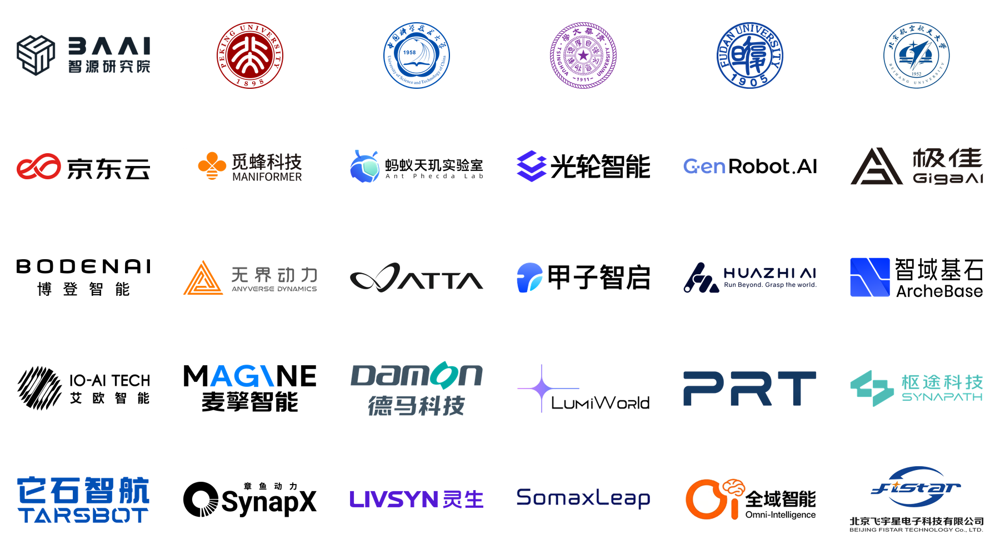

# Reference

## CLI

```bash
humancoin-download --help
humancoin-visualize --help
humancoin-visualize-web --help
```

| Command | Purpose |
|---------|---------|
| `humancoin-download` | download complete repositories from Hugging Face or ModelScope |
| `humancoin-visualize` | desktop viewer |
| `humancoin-visualize-web` | browser viewer |

## Comparison

| Dataset | Hours | Cameras | Depth / 3D | Gaze | sEMG | EEG | Finger kinematics |
|---------|-------|---------|------------|------|------|-----|-------------------|
| Ego4D | 3,670 | 1 head | subset | subset | – | – | subset |
| Ego-Exo4D | 1,286 | head + 4–5 exo | reconstructed | ✓ | – | – | ✓ |
| EgoDEX | 829 | 1 head | – | – | – | – | ✓ |
| EgoBrain | 61 | 1 head | – | – | – | ✓ | – |
| Xperience-10M | 10,000 | 6 head | reconstructed | – | – | – | ✓ |
| **HumanCOIN** | **12,500** | **2–6 head, 2 wrist\*, exo\*** | **reconstructed** | **✓ / P** | **✓** | **✓\*** | **✓ / P** |

`✓` measured, `P` predicted, `–` not provided, `*` subset of the corpus.

## FAQ

**The download returns 401/403.** Request access to the gated repository and authenticate with an approved account (`hf auth login`, or `MODELSCOPE_TOKEN`).

**`meta/info.json` is missing.** For an L1 repository, descend into a `<task>/` directory; L2/L3 are flat.

**A window is empty.** The query may be before the sensor's `timestamp_start`, inside a gap, or the release may use a different feature key. Print `ds.meta.features`.

**Which tier should I start with?** L1 for scale and scene coverage; L2 for EMG; L3 for EEG and measured reference signals.

**Can I train a robot policy directly?** Not directly: the action is a 58-D human signal, and the format is per-stream. See [Using the data](usage.md).

## Citation

```text
@article{wu2026humancoin,
  title   = {HumanCOIN: A 12,500-Hour Dataset for Human Intent in Egocentric Manipulation},
  author  = {Wu, Shihan and Liu, You and He, Chunyu and Qin, Minghui and Jiao, Longhan and
             Guo, Jinbang and Xie, Shaoxuan and Tian, Kaixi and Chen, Wenjie and Pang, Jingrui and
             Zhang, Yuanhang and Zhang, Yichi and Liu, Miao and Pan, Tengfei and Jiao, Yance and
             Zhang, Yunyan and Li, Yihang and Shen, Yongjian and Liu, Li and Zhu, Kai and
             Fang, Chen and Chen, Jianxing and Liu, Sihan and Wang, Xiaofeng and Zhao, Jie and
             Li, Jing and Wang, Yueqi and Tang, Yichen and Li, Wei and Yang, Zhexuan and Cao, Yue and
             Zhao, Ji and Wang, Kai and Jiang, Dongsheng and Wang, Yongwei and Mu, Wei and
             Pang, Jiangmiao and Yao, Maoqing and Ding, Wenchao and Zhu, Zheng and Xia, Zhongpu and
             Du, Dalong and Niu, Jianwei and Gao, Dahui and Yu, Zhiwei and Lei, Bo and Yang, Huan and
             Lin, Yonghua and Huang, Tiejun and Wang, Zhongyuan and Yao, Guocai},
  journal = {arXiv preprint arXiv:2611.26434},
  year    = {2026}
}
```

## License

- Data: CC BY-NC 4.0 — research and non-commercial use.
- Code: Apache-2.0.
- Paper: [arXiv:2611.26434](https://arxiv.org/abs/2611.26434).

## Collaborating institutions

<p align="center">
  
</p>
