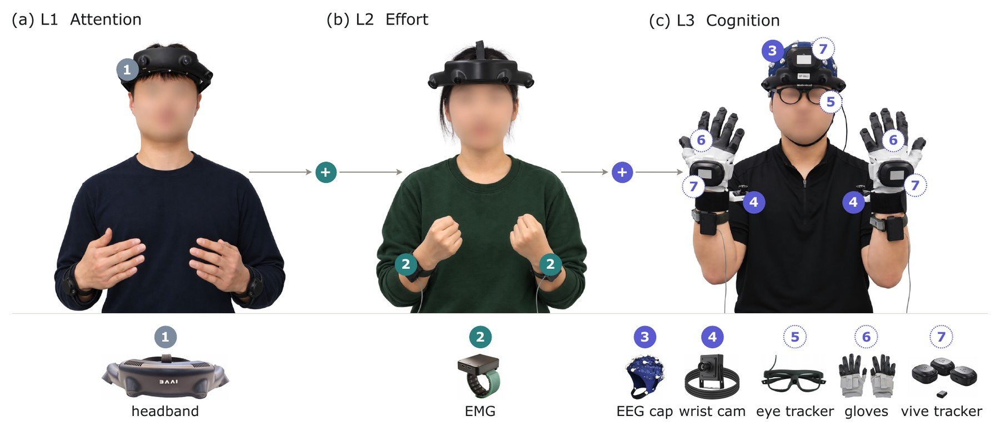

# 采集与处理

  
   
  三套设备：L1 头环；L2 增加肌电臂环；L3 增加脑电、腕部相机、眼动仪、手套与 tracker。图源：论文。

## 硬件配置

| 层级 | 数据流 | 设备（示例） | 原生分辨率 / 通道 | 频率 | 单位 |
|------|--------|--------------|-------------------|------|------|
| L1 | 头部 RGB | 14 款第三方头环、13 家厂商、2–6 目 | 512×512–3840×1200 | 20–60 fps | RGB |
| L2 | 头部 RGB | 四目头环，前向立体对同步 | 1920×1200 | 30 fps | RGB |
| L2/L3 | 腕部 RGB | JIERUIWEITONG FH868 | 640×480（部分 L2 发布为 1920×1080） | 30 fps | RGB |
| L3 | 眼动场景相机 | Pupil Labs Neon | 1600×1200 | 30 fps | RGB |
| L3 | 第三人称 | Intel RealSense D455f | 640×480 | 30 fps | RGB-D |
| L3 | 注视 | Pupil Labs Neon | x, y 像素 | 200 Hz | px |
| L3 | 头/腕位姿 | HTC VIVE Tracker 3.0 ×3 | 同一坐标系下的 6-DoF | 设备约 800 Hz | mm / deg |
| L3 | 手指运动学 | MANUS Metaglove Pro | 每手 20 个关节 | 设备约 800 Hz | deg |
| L2/L3 | 表面肌电 | WLEMGUV2A ×2 | 每臂 8 通道 | 2 kHz | mV |
| L3 | 脑电（受控） | Neuroscan SynAmps2 | 128 通道 | 1 kHz | µV |
| L3 | 脑电（开放） | BrainCo BCIGo | 32/8 通道 | 250 Hz | µV |

发布流可能被降采样，实际形状以 `meta/info.json` 为准。设备之间不做菊花链：单一主机接收所有数据流并记录到达偏移，因此每台设备保留自己的时钟和原生频率。并口盒把阶段/run 切换写入脑电放大器。

## 开放与受控

L1 和 L2 在**开放环境**采集：可穿戴设备、头环计算机、自由走动。L2 和 L3 用任务单固定物体摆放和步骤顺序。L3 还有**受控环境**：固定桌面、稳定光照、有时限 session，以满足高密度脑电、眼动和动捕对静止姿态的要求。

受控 session 分两段。**运动想象（imagery）**：屏幕变蓝，操作者坐直不动，在脑中预演任务，只记录脑电和注视。**执行（execution）**：屏幕变绿，同一任务真正执行，所有模态同时记录。`run start`、`imagine`、`execute`、`run end` 等标记写入记录，因此两段可以按同一时间基切出来。

## 从原始信号到发布表

| 阶段 | 做什么 | 发布什么 |
|------|--------|----------|
| 同步与标定 | 样本相对 episode 起点打时间戳；记录到达偏移；相机、tracker 与眼动仪按 session 标定。 | 时间戳、内参、畸变、校正参数与 tracker 变换。 |
| 几何与运动 | 深度由同步立体对经 FoundationStereo 得到；逐帧投影点云；手部在重叠视频窗口上重建并锚定到深度。 | 深度、点云、头/腕/胸位姿与手指运动学。 |
| 注视 | 受控 L3 由眼动仪以 200 Hz 实测；其余由视频模型以 30 Hz 预测。 | `eye_gaze` 与 `eye_gaze_predict`。 |
| 肌电 | 零相位 20–450 Hz 带通与 50 Hz 梳状陷波；保留原始与去噪轨迹。 | `*_emg_raw` / `*_emg_denoise`。 |
| 脑电 | 去均值、0.5–100 Hz 带通、50 Hz 陷波、坏导联检测、ICA、插值与平均参考。 | 原始与清洗后的脑电表。 |
| 标注与质检 | Argus + Qwen 生成步骤标注，人工审核；每条 session 写完后逐流检查。 | 结构化标注 JSON、`qc_reports.jsonl`；失败 session 重采。 |

## 隐私与许可

所有参与者签署书面知情同意，并可随时退出。发布 episode 已去标识化，所有视角中的人脸都做了模糊处理。数据以 CC BY-NC 4.0 发布，代码使用 Apache-2.0。
