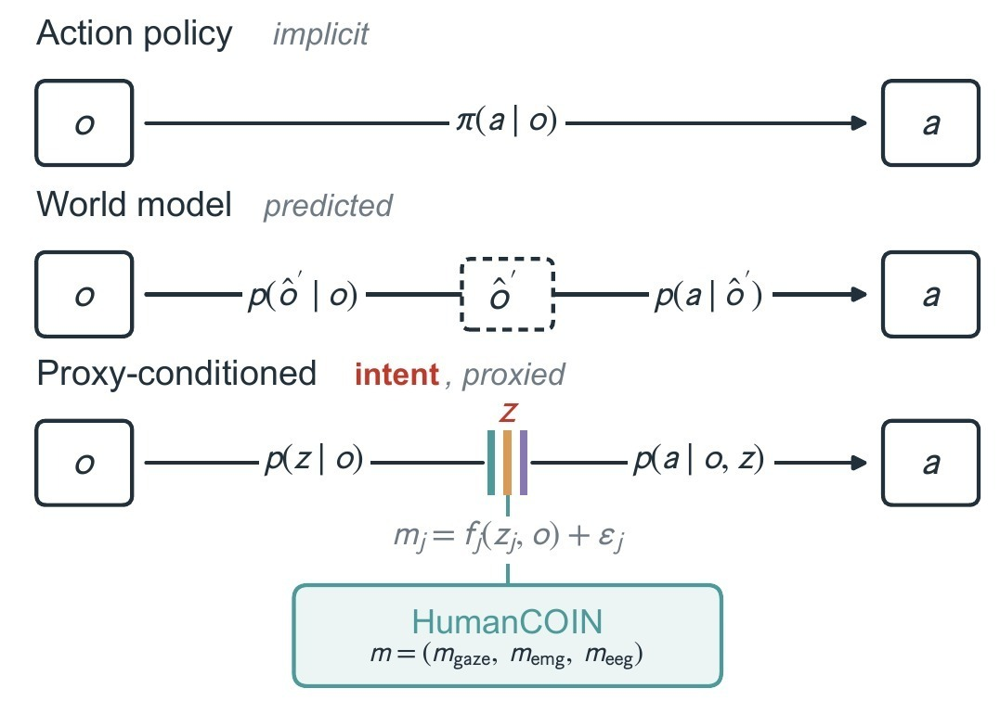
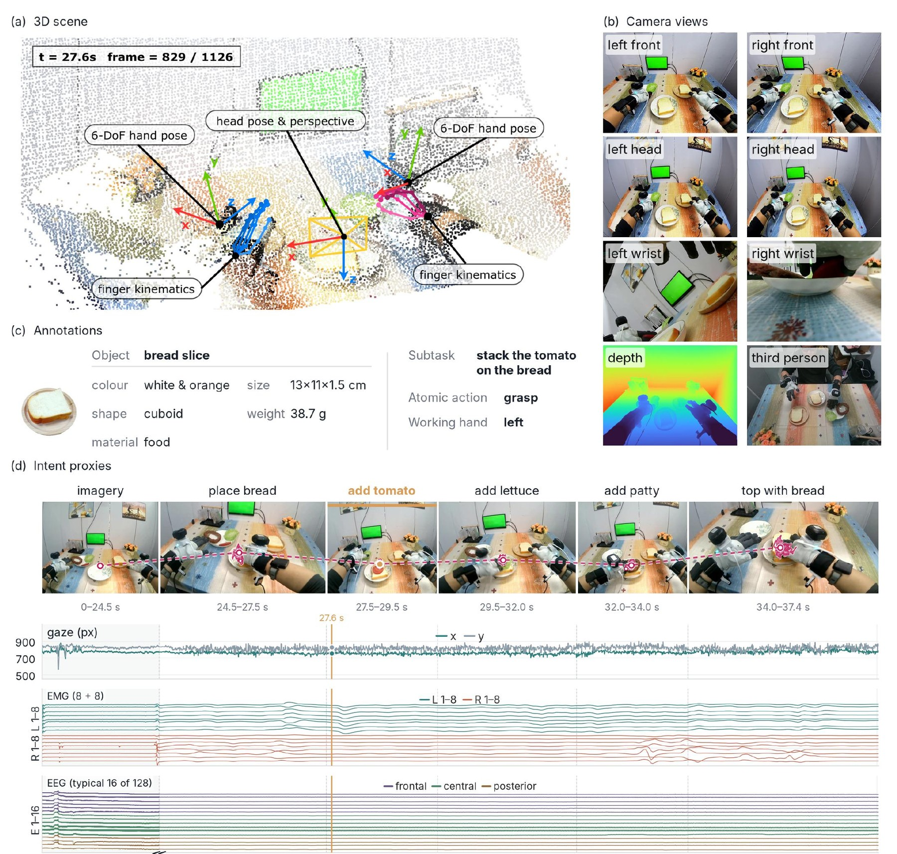
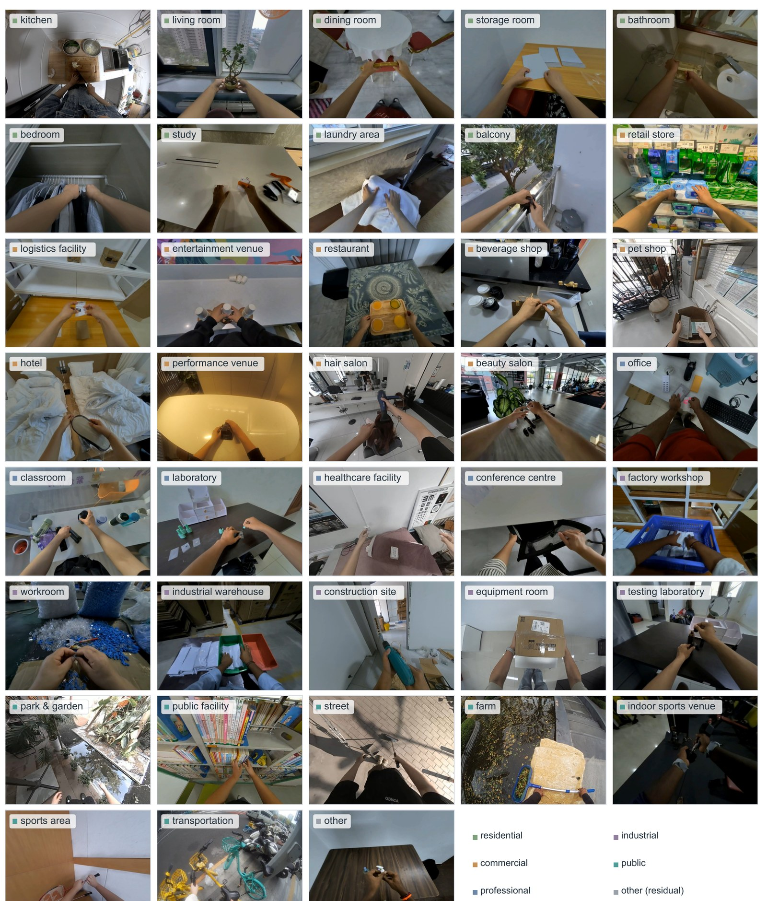

# 数据里有什么

HumanCOIN 在视觉–动作对之外记录操作者的意图通路。本页说明科学框架，以及一条 episode 里包含什么。

## 形式化视角

令 `o` 为观测、`a` 为动作、`z` 为操作者的潜在意图。标准策略把 `z` 边缘化掉：

$$
p(a \mid o) = \int p(a \mid o, z)\, p(z \mid o)\, \mathrm{d}z .
$$

HumanCOIN 不直接观测 `z`，而是记录意图通路上的代理向量：

$$
m_j = f_j(z_j, o) + \varepsilon_j, \qquad j \in \{\mathrm{gaze},\ \mathrm{emg},\ \mathrm{eeg}\},
$$

其中 `f_j` 是传感器相关的有损读出函数，`ε_j` 是噪声；`m` 不是 `z` 的充分统计量。语料支持两个监督问题：

$$
\max_\phi\ \mathbb{E}_{(o,m)}\left[\log p_\phi(m \mid o)\right],
\qquad
\max_\theta\ \mathbb{E}_{(o,m,a)}\left[\log p_\theta(a \mid o, m)\right].
$$

前者学习代理模型，后者学习以代理信号为条件的策略。关心的问题是代理信号是否携带观测之外的动作信息：

$$
I(a; m \mid o) = \mathbb{E}[\log p(a \mid o, m) - \log p(a \mid o)].
$$

  
   
  动作策略把意图折进权重；世界模型预测未来；HumanCOIN 记录意图的代理信号。图源：论文。

## 三个层级

每层继承下一层的全部代理信号，再增加一种。信号越深，小时数越少。

| 层级 | 小时数 | 新增代理 | 典型数据流 | 环境 | 场景 |
|------|--------|----------|------------|------|------|
| **L1 · 注意** | 10,000 | 从头环视频估计注视 | 2–6 路头部相机、深度、位姿 | 开放，不设脚本 | 38 |
| **L2 · 用力** | 2,000 | 双侧 sEMG，每臂 8 通道 @2 kHz | 4 目头环、2 路腕部视角 | 开放，任务单 | 21 |
| **L3 · 认知** | 500 | EEG 128 通道 @1 kHz（受控）或 32/8 通道 @250 Hz（开放） | 4 头部 + 2 腕部 + 眼动 + 第三人称、眼动仪、tracker、手套 | 约 350 h 受控 + 150 h 开放 | 9 |

L1 不含肌电和脑电；L2 增加肌电；L3 增加脑电，并在受控子集中直接测量注视、头/腕位姿和手指运动学。受控 L3 的实测值是浅层估计值的**参考**，不是意图本身的真值。

## 一条 episode

  
   
  受控 L3 episode，t = 27.6 s：点云与 6-DoF 位姿、同步视角、步骤标注，以及同一时间轴上的注视/肌电/脑电。图源：论文。

### 视角与几何

- **头部相机。** L1 使用 14 款来自 13 家厂商的第三方头环：2–6 目，20–60 fps，512×512（校正后）到 3840×1200。L2/L3 使用 1920×1200、30 fps 的四目头环，前向立体对硬件同步。发布流可能被降采样，形状以 `meta/info.json` 为准。
- **腕部与第三人称。** L2 增加两路腕部视角。L3 增加两个 640×480 腕部相机、一路 1600×1200 眼动仪场景相机，受控子集还有第三人称 RGB-D。
- **深度与点云。** 深度由前向立体对经 FoundationStereo 重建，连同内参存储，并逐帧投影成点云。发布同时提供原始与校正版本时就都保留。
- **位姿与手。** 头部、双腕和胸部共享一个度量坐标系：`+x` 向左、`+y` 向上、`+z` 向前；平移单位毫米，关节角单位度。位姿流可能存 7 个数（位置 + 四元数）或 6 个数（位置 + 欧拉角），读取 `names` 确认。受控 L3 用 3 个 6-DoF tracker 与 20 节点手套；其余情况从视频估计。

### 意图代理

| 代理 | 典型数据流 | 频率 | 实测/估计 |
|------|------------|------|-----------|
| 注视 | `observation.eye_gaze`（受控 L3）；`eye_gaze_predict`（其余） | 实测 200 Hz；估计 30 Hz | 受控 L3 实测 |
| 表面肌电 | `observation.left_wrist_emg`、`right_wrist_emg`，raw/denoised 变体 | 2 kHz，每臂 8 通道 | L2 起实测 |
| 脑电 | `observation.eeg_raw`、`eeg_denoise` | 1 kHz × 132（128 通道帽）；250 Hz × 32/8 | L3 实测 |

注视坐标是眼动仪场景相机像素（受控 L3），或校正后头部视角像素。肌电发布原始与去噪轨迹；需要包络时自行计算。脑电按采集、滤波、修复等阶段发布。键名随发布变化，先打印 `ds.meta.features`。

### 场景

  
   
  每个场景类取一帧头戴相机画面，按功能区排列。图源：论文。

语料覆盖 5 个功能区（居住、商业、专业、工业、公共）共 38 类，另有 1 个残差类。L3 收窄到 9 类能容纳固定桌面、稳定光照和有时限 session 的场景。

### 标注

标注以步骤为单位。每个步骤包含一句描述、一个**任务动词**（99 类）、使用的手、接触到的物体，以及一组**动作动词**（46 类，平均每步 2.5 个）。L2/L3 的物体记录可以包含实测的形状、尺寸、重量、材质和颜色。

每条 episode 还带有任务阶段、关键事件、状态变化，以及受控 L3 中「运动想象 / 执行」的阶段标记。标注以结构化 JSON 和 LeRobot 语言列发布。
