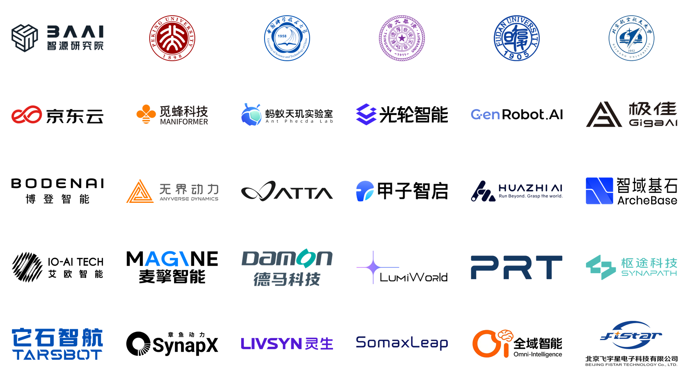

# 关于

命令行、数据集对比、常见问题、引用与许可，以及 HumanCOIN 的合作机构。

## 命令行

```bash
humancoin-download --help
humancoin-visualize --help
humancoin-visualize-web --help
```

| 命令 | 用途 |
|------|------|
| `humancoin-download` | 从 Hugging Face 或 ModelScope 下载完整仓库 |
| `humancoin-visualize` | 桌面可视化器 |
| `humancoin-visualize-web` | 浏览器可视化器 |

## 与其他数据集对比

| 数据集 | 小时数 | 相机 | 深度 / 3D | 注视 | 表面肌电 | 脑电 | 手指运动学 |
|--------|--------|------|-----------|------|----------|------|------------|
| Ego4D | 3,670 | 1 路头部 | 子集 | 子集 | – | – | 子集 |
| Ego-Exo4D | 1,286 | 头部 + 4–5 路第三人称 | 重建 | ✓ | – | – | ✓ |
| EgoDEX | 829 | 1 路头部 | – | – | – | – | ✓ |
| EgoBrain | 61 | 1 路头部 | – | – | – | ✓ | – |
| Xperience-10M | 10,000 | 6 路头部 | 重建 | – | – | – | ✓ |
| **HumanCOIN** | **12,500** | **2–6 头部、2 腕部\*、第三人称\*** | **重建** | **✓ / P** | **✓** | **✓\*** | **✓ / P** |

`✓` 实测，`P` 预测，`–` 未提供，`*` 子集。

## FAQ

**下载返回 401/403？** 先申请受限仓库的访问权限，再用获批账号认证（`hf auth login` 或 `MODELSCOPE_TOKEN`）。

**找不到 `meta/info.json`？** L1 仓库要进入 `<task>/` 子目录；L2/L3 是扁平的。

**窗口为空？** 可能查询在传感器的 `timestamp_start` 之前、落在缺口里，或发布使用了不同的特征键。打印 `ds.meta.features`。

**从哪一层开始？** 规模与场景覆盖用 L1；肌电用 L2；脑电与实测参考用 L3。

**能直接训练机器人策略吗？** 不能直接：动作是 58 维人体信号，格式也是逐流的。见[使用数据](usage.md)。

## 引用

```text
@article{wu2026humancoin,
  title   = {HumanCOIN: A 12,500-Hour Dataset for Human Intent in Egocentric Manipulation},
  author  = {Wu, Shihan and Liu, You and He, Chunyu and Qin, Minghui and Jiao, Longhan and
             Guo, Jinbang and Xie, Shaoxuan and Tian, Kaixi and Chen, Wenjie and Pang, Jingrui and
             Zhang, Yuanhang and Zhang, Yichi and Liu, Miao and Pan, Tengfei and Jiao, Yance and
             Zhang, Yunyan and Li, Yihang and Shen, Yongjian and Liu, Li and Zhu, Kai and
             Fang, Chen and Chen, Jianxing and Liu, Sihan and Wang, Xiaofeng and Zhao, Jie and
             Li, Jing and Wang, Yueqi and Tang, Yichen and Li, Wei and Yang, Zhexuan and Cao, Yue and
             Zhao, Ji and Wang, Kai and Jiang, Dongsheng and Wang, Yongwei and Mu, Wei and
             Pang, Jiangmiao and Yao, Maoqing and Ding, Wenchao and Zhu, Zheng and Xia, Zhongpu and
             Du, Dalong and Niu, Jianwei and Gao, Dahui and Yu, Zhiwei and Lei, Bo and Yang, Huan and
             Lin, Yonghua and Huang, Tiejun and Wang, Zhongyuan and Yao, Guocai},
  journal = {arXiv preprint arXiv:2611.26434},
  year    = {2026}
}
```

## 许可

- 数据：CC BY-NC 4.0，仅限研究与非商业用途。
- 代码：Apache-2.0。
- 技术报告：[arXiv:2611.26434](https://arxiv.org/abs/2611.26434)。

## 合作机构

<p align="center">
  
</p>
