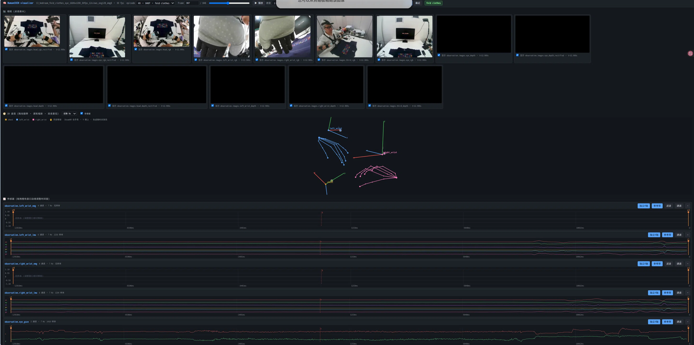

# 可视化

## 浏览器可视化器

```bash
# DATASET_ROOT 是任务目录；扁平的 L2/L3 直接用仓库根目录
humancoin-visualize-web "<dataset-root>"
# 需要时指定端口或监听地址
humancoin-visualize-web "<dataset-root>" --port 8080 --no-browser
```

页面包含同步相机面板、逐路信号条、可拖动时间窗；数据里有对应流时显示 3D 位姿/手骨架；发布中包含阻抗快照时显示脑电电极网格。

脑电/肌电条上可以做零相位 Butterworth 高通/低通和工频梳状陷波，也可以通过 API 传入：

```text
filt=observation.eeg_denoise:hp=0.5,lp=40,notch=50
```

<p align="center">
  
  <br>
  <sub>真实 L3 episode（第 381/848 帧）：相机墙、3D 位姿、肌电/IMU 与注视信号条共用主时间轴。</sub>
</p>

## 桌面可视化器

```bash
humancoin-visualize "<dataset-root>" --episode 0
```

| 按键 | 作用 |
|------|------|
| `space` | 播放 / 暂停 |
| `←` `→` | 上一帧 / 下一帧 |
| `↑` `↓` | 加快 / 减慢 |
| `w` `s` | 放宽 / 收窄时间窗 |
| `q` / `Esc` | 退出 |

桌面版会把每一路流都画成信号条。L3 有 132 列脑电时，浏览器界面更易读。

## 门户预览

[数据门户](https://flagopen.github.io/HumanCOIN-DataManager/) 可以在下载前预览：封面帧、传感器列表、episode 数、时长、大小和许可。完整视频预览从 Hugging Face 加载，受限仓库需要权限。
