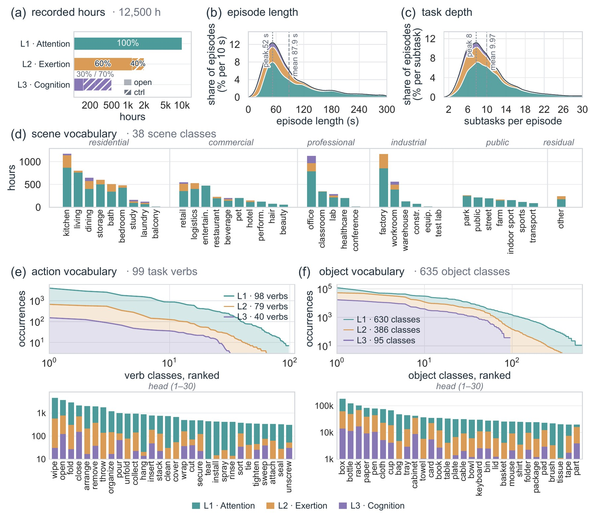

# HumanCOIN

> 中文文档：[中文](../zh/)

  

**A 12,500-hour egocentric manipulation dataset that records the signals behind the action — gaze, surface EMG and EEG — at three measurement depths, on one task ontology and one time base.**

  <a href="https://flagopen.github.io/HumanCOIN/">Project page</a> ·
  <a href="https://arxiv.org/abs/2611.26434">Paper (arXiv:2611.26434)</a> ·
  <a href="https://flagopen.github.io/HumanCOIN-DataManager/">Data portal</a> ·
  <a href="https://github.com/FlagOpen/HumanCOIN">GitHub</a>

HumanCOIN records what happens between seeing and acting. Most egocentric datasets keep an observation–action pair; HumanCOIN adds wearable proxies for the operator's intent along the pathway from decision to effect:

- **gaze** — where attention lands before the hand moves;
- **surface EMG** — how the forearm loads grip force before contact;
- **scalp EEG** — what the cortex prepares before the motor command.

The corpus is organised as three nested tiers: **L1 Attention** (10,000 h), **L2 Exertion** (2,000 h) and **L3 Cognition** (500 h). Each tier inherits the proxies of the tier below and adds one more. Every tier carries multi-view RGB, depth and point clouds, 6-DoF pose and finger kinematics; L3's controlled subset measures gaze, pose and finger motion directly as reference.

## At a glance

| Axis | Value |
|------|-------|
| Scale | 12,500 h · 1.35 B master frames at 30 fps · 6 sites |
| Scenes | 38 classes in 5 zones + 1 residual |
| Tasks | 99 task verbs + 46 motion verbs |
| Objects | 635 annotated classes; 839 measured instances |
| Signals | multi-view RGB, depth, 6-DoF pose, hand kinematics, gaze, sEMG, EEG, IMU, microphone |
| Format | LeRobot-style: one Parquet per stream + master index; MP4 and WAV |

  
   
  Tier hours, episode length, task depth, 38 scene classes, task verbs and object classes. Figure from the paper.

## Start here

- **[Getting started](getting-started.md)** — install, download one repository, read a frame.
- **[What is in the data](data.md)** — the formal framing, tiers, episode anatomy and annotations.
- **[On-disk format](format.md)** — layout, timestamps, master index and per-stream tables.
- **[Download](download.md)** — the data portal, CLI and ModelScope access.
- **[Reading and alignment](reading.md)** — windows, nearest sampling and interpolation.
- **[Visualization](visualization.md)** — browser and desktop viewers.
- **[Using the data](usage.md)** — default frames plus a gaze/EMG/EEG demo.
- **[Collection and processing](collection.md)** — hardware, protocol and QC.
- **[Reference](reference.md)** — CLI, comparison, FAQ and citation.

> **Catalog vs. corpus.** 12,500 h is the full documented corpus. Data is released in batches; check the [data portal](https://flagopen.github.io/HumanCOIN-DataManager/) for the live catalog. The 2026-11 snapshot listed 689 repositories, 12,119 episodes and roughly 530 h.
