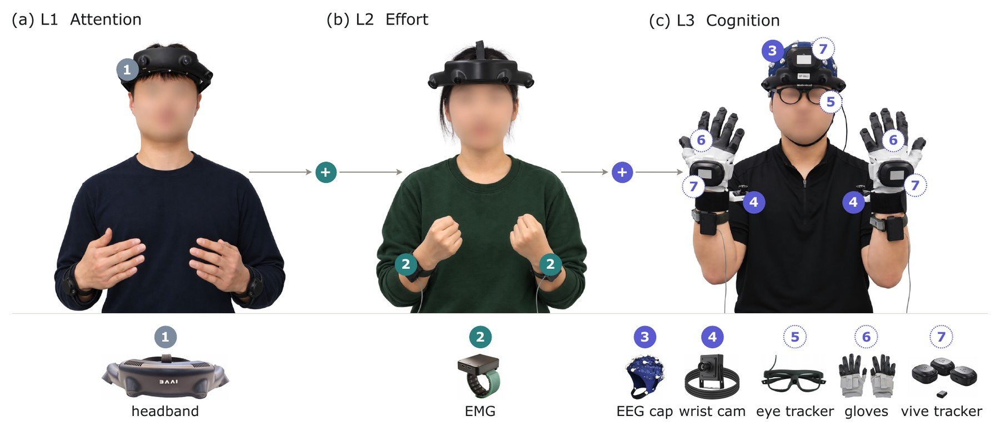

# Collection and processing

  
   
  The three kits: L1 headbands; L2 adds EMG armbands; L3 adds EEG, wrist cameras, eye tracker, gloves and trackers. Figure from the paper.

## Hardware configuration

| Tier | Stream | Device (example) | Native resolution / channels | Rate | Unit |
|------|--------|------------------|------------------------------|------|------|
| L1 | head RGB | 14 third-party headbands, 13 vendors, 2–6 lenses | 512×512–3840×1200 | 20–60 fps | RGB |
| L2 | head RGB | four-camera headband, synchronized front pair | 1920×1200 | 30 fps | RGB |
| L2/L3 | wrist RGB | JIERUIWEITONG FH868 | 640×480 (up to 1920×1080 in some L2 releases) | 30 fps | RGB |
| L3 | eye scene camera | Pupil Labs Neon | 1600×1200 | 30 fps | RGB |
| L3 | third-person | Intel RealSense D455f | 640×480 | 30 fps | RGB-D |
| L3 | gaze | Pupil Labs Neon | x, y pixel | 200 Hz | px |
| L3 | head / wrist pose | HTC VIVE Tracker 3.0 ×3 | 6-DoF in one frame | ≈800 Hz device | mm / deg |
| L3 | fingers | MANUS Metaglove Pro | 20 joints per hand | ≈800 Hz device | deg |
| L2/L3 | surface EMG | WLEMGUV2A ×2 | 8 ch per arm | 2 kHz | mV |
| L3 | EEG, controlled | Neuroscan SynAmps2 | 128 ch | 1 kHz | µV |
| L3 | EEG, open | BrainCo BCIGo | 32/8 ch | 250 Hz | µV |

Released streams may be downscaled; read `meta/info.json`. No instrument is daisy-chained: one host receives every stream and stamps arrival offsets, so each device keeps its clock and rate. A parallel-port box stamps phase/run transitions into the EEG amplifier.

## Open vs. controlled

L1 and L2 are collected in the **open setting**: wearable instruments, a headband computer, free movement. L2 and L3 use task sheets to stage objects and step order. L3 also has a **controlled setting** at a fixed desk, where dense EEG, eye tracking and motion capture require a still posture.

Controlled sessions run in two phases. **Imagery:** the screen turns blue, the operator sits still and rehearses the task while EEG and gaze are recorded. **Execution:** the screen turns green and the task is performed with every modality live. Phase markers (`run start`, `imagine`, `execute`, `run end`) let the phases be cut on a common time base.

## From raw signals to released tables

| Stage | What is done | What ships |
|-------|--------------|------------|
| Synchronization and calibration | Samples stamped relative to episode start; arrival offsets recorded; cameras, trackers and eye tracker calibrated per session. | Timestamps, intrinsics, distortion, rectification and tracker transforms. |
| Geometry and motion | Depth from FoundationStereo on the synchronized pair; point clouds per frame; hands reconstructed over video windows and anchored in depth. | Depth, point clouds, head/wrist/chest pose and finger kinematics. |
| Gaze | Measured at 200 Hz by the eye tracker in controlled L3; predicted at 30 Hz elsewhere. | `eye_gaze` and `eye_gaze_predict`. |
| EMG | Zero-phase 20–450 Hz band-pass and 50 Hz comb notch; raw and denoised traces kept. | `*_emg_raw` / `*_emg_denoise`. |
| EEG | De-mean, 0.5–100 Hz band-pass, 50 Hz notch, bad-channel detection, ICA, interpolation and average reference. | Raw and cleaned EEG tables. |
| Annotation and QC | Argus over Qwen proposes step labels; a human reviews. Every session is checked after writing. | Structured annotation JSON, `qc_reports.jsonl`; failing sessions are recaptured. |

## Privacy and license

All participants gave written informed consent and could withdraw. Released episodes are de-identified; faces are blurred in every view. Data is CC BY-NC 4.0; code is Apache-2.0.
