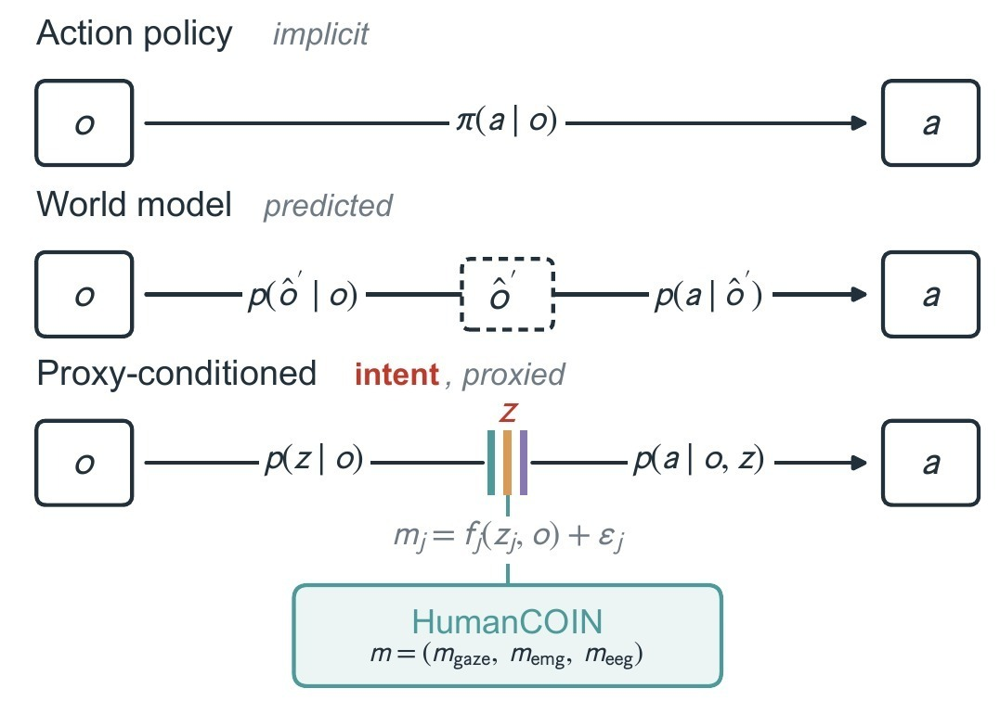
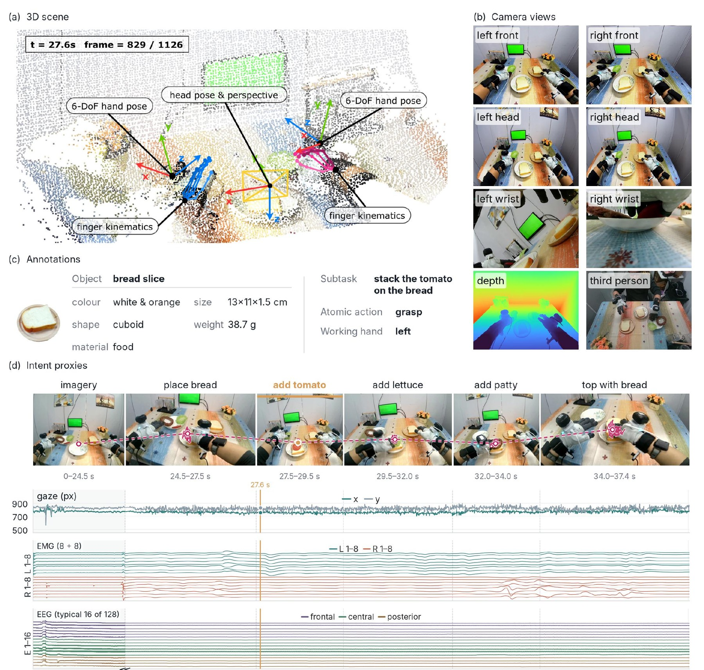
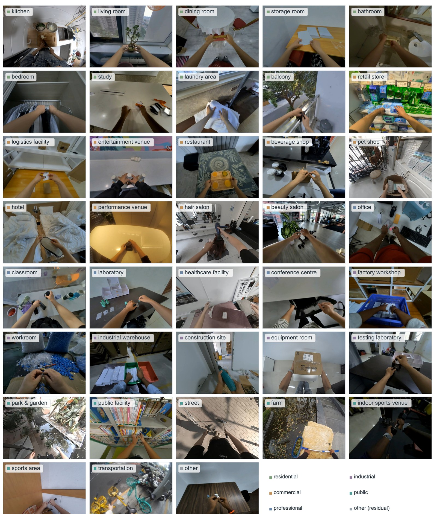

# What is in the data

HumanCOIN records the operator's intent pathway alongside every visual–action pair. This page explains the scientific framing and what a single episode contains.

## A formal view

Let `o` be the observation, `a` the action and `z` the operator's latent intent. A standard policy marginalises `z` away:

$$
p(a \mid o) = \int p(a \mid o, z)\, p(z \mid o)\, \mathrm{d}z .
$$

HumanCOIN does not observe `z` directly. It records a vector of proxies along the intent pathway:

$$
m_j = f_j(z_j, o) + \varepsilon_j, \qquad j \in \{\mathrm{gaze},\ \mathrm{emg},\ \mathrm{eeg}\},
$$

where `f_j` is a lossy, sensor-specific readout and `ε_j` is noise; `m` is not a sufficient statistic for `z`. The corpus supports two supervised problems:

$$
\max_\phi\ \mathbb{E}_{(o,m)}\left[\log p_\phi(m \mid o)\right],
\qquad
\max_\theta\ \mathbb{E}_{(o,m,a)}\left[\log p_\theta(a \mid o, m)\right].
$$

The first learns a proxy model; the second learns a proxy-conditioned policy. The question of interest is whether `m` carries information about `a` beyond `o`:

$$
I(a; m \mid o) = \mathbb{E}[\log p(a \mid o, m) - \log p(a \mid o)].
$$

  
   
  An action policy folds intent into its weights; a world model predicts the future; HumanCOIN records proxies for intent. Figure from the paper.

## Three tiers

Each tier inherits every proxy of the tier below and adds one more. Hours decrease with signal depth.

| Tier | Hours | Added proxy | Typical streams | Setting | Scenes |
|------|-------|-------------|-----------------|---------|--------|
| **L1 · Attention** | 10,000 | gaze estimated from headband video | 2–6 head cameras, depth, pose | open, unscripted | 38 |
| **L2 · Exertion** | 2,000 | bilateral sEMG, 8 ch/arm @ 2 kHz | 4-camera headband, 2 wrist views | open, task sheets | 21 |
| **L3 · Cognition** | 500 | EEG 128 ch @ 1 kHz (controlled) or 32/8 ch @ 250 Hz (open) | 4 head + 2 wrist + eye + third-person, eye tracker, trackers, gloves | ≈350 h controlled + ≈150 h open | 9 |

L1 has no EMG or EEG; L2 adds EMG; L3 adds EEG and, in its controlled subset, direct measurements of gaze, head/wrist pose and finger kinematics. Those measurements are the **reference** for the estimates used in shallower tiers — not ground truth for intent.

## One episode

  
   
  One controlled L3 episode at t = 27.6 s: point cloud and 6-DoF poses, synchronized views, step annotation, and gaze/EMG/EEG on one time axis. Figure from the paper.

### Views and geometry

- **Head cameras.** L1 uses 14 third-party headbands from 13 vendors: 2–6 lenses, 20–60 fps, from 512×512 rectified to 3840×1200. L2/L3 use a four-lens headband at 1920×1200 and 30 fps; the front pair is hardware-synchronized. Released streams may be downscaled — read the shape from `meta/info.json`.
- **Wrist and third-person.** L2 adds two wrist views. L3 adds two 640×480 wrist cameras, a 1600×1200 eye-tracker scene camera, and a third-person RGB-D view in the controlled subset.
- **Depth and point clouds.** Depth is reconstructed from the front stereo pair with FoundationStereo, stored with the intrinsics that produced it, and projected per frame. Camera views are released raw and rectified where the release provides both.
- **Pose and hands.** Head, wrists and chest share one metric frame: `+x` left, `+y` up, `+z` forward; translations in millimetres, joint angles in degrees. Pose streams use either 7 values (position + quaternion) or 6 values (position + Euler angles); read `names`. Controlled L3 uses three 6-DoF trackers and 20-node gloves; elsewhere pose and hands are estimated from video.

### Intent proxies

| Proxy | Stream (typical) | Rate | Measured or estimated |
|-------|------------------|------|-----------------------|
| Gaze | `observation.eye_gaze` (controlled L3); `eye_gaze_predict` (elsewhere) | 200 Hz measured; 30 Hz estimated | measured in controlled L3 |
| Surface EMG | `observation.left_wrist_emg`, `right_wrist_emg`, raw/denoised variants | 2 kHz, 8 ch/arm | measured from L2 |
| EEG | `observation.eeg_raw`, `eeg_denoise` | 1 kHz × 132 (128-ch cap); 250 Hz × 32/8 | measured at L3 |

Gaze is a pixel coordinate in the eye-tracker scene camera (controlled L3) or the rectified head view. EMG is released as raw and denoised traces; derive an envelope if needed. EEG is released as acquired, filtered and repaired where available. Exact keys vary by release — print `ds.meta.features`.

### Scenes

  
   
  One head-camera frame per scene class, grouped by zone. Figure from the paper.

The corpus spans 38 scene classes in five zones — residential, commercial, professional, industrial and public — plus one residual class. L3 contracts to nine classes that can host a fixed desk, stable lighting and a bounded session.

### Annotations

Annotation is step-level. Every step carries a sentence, a **task verb** (99 classes), a working hand, the objects it touches, and **motion verbs** (46 classes, on average 2.5 per step). At L2/L3 the object record can include measured shape, size, weight, material and colour.

Episodes also carry timed task stages, key events, state changes, and — in controlled L3 — phase markers for imagery and execution. Annotation ships as structured JSON and as LeRobot language columns.
