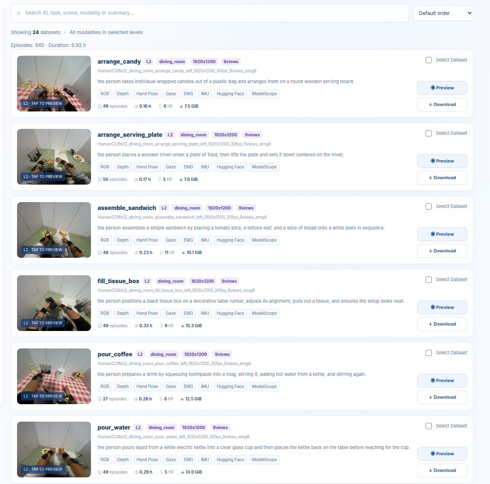
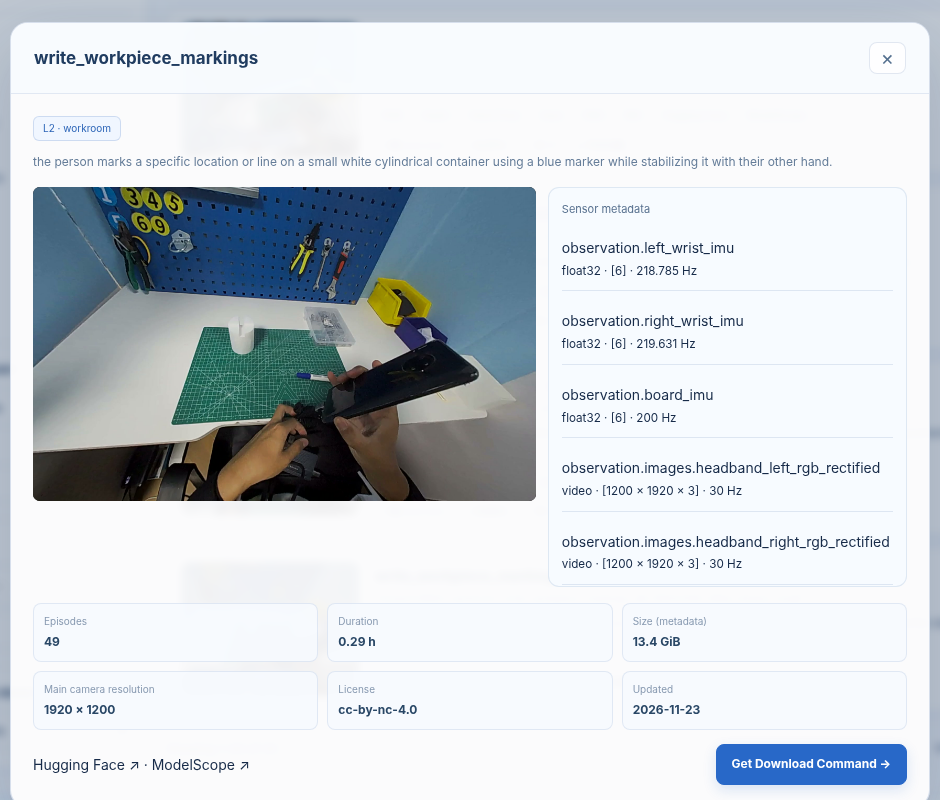
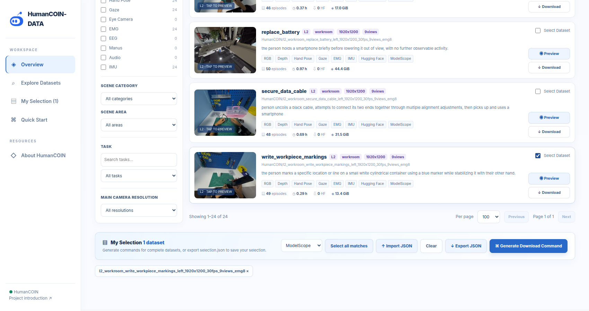

# Download

Two supported routes: the portal with the command it generates, or the same `humancoin-download` command typed by hand.

## The data portal

The **[HumanCOIN DataManager](https://flagopen.github.io/HumanCOIN-DataManager/)** is the public catalog for released data.

<p align="center">
  
  <br>
  <sub>Explore Datasets: search and compare released repositories; each card exposes its sensor set, size and Preview/Download actions.</sub>
</p>

<p align="center">
  
  <br>
  <sub>A dataset card: task, per-stream metadata, episode count, duration, size, license, and Get Download Command.</sub>
</p>

1. **Browse.** Filter by data level, modality, scene, task and main-camera resolution.
2. **Preview.** Check the task, stream list, episodes, duration, size and license.
3. **Select.** Tick one or more complete repositories. The selection is kept in browser storage and can be exported/imported as `selection.json`.
4. **Choose a source.** Hugging Face or ModelScope. A repository may exist on one hub only.
5. **Generate the command.** The command selects the revision shown on the card.

```bash
humancoin-download --hub huggingface \
  --datasets 'HumanCOIN/<repository>' \
  --revision '<commit-or-master>' \
  --target-dir ./data --max-workers 8
```

Run it in the terminal where you authenticated. `--dry-run` prints the destination and include/exclude patterns without downloading.

## Repository names

```text
l1_study_room_fill_task_1920x1456_30fps_2views
│  │          │    │        │      │     └─ released camera views
│  │          │    │        │      └─ frame rate
│  │          │    │        └─ main camera resolution
│  │          │    └─ task
│  │          └─ scene
│  └─ tier
```

L2/L3 names add the sensor kit, e.g. `..._9views_emg8` or `..._12views_eeg128_emg8`.

## CLI

```bash
humancoin-download --help
# or: python -m humancoin.download --help
```

| Flag | Meaning |
|------|---------|
| `--hub {huggingface,modelscope}` | source hub |
| `--datasets A B ...` | one or more repository names or `owner/name` IDs |
| `--revision REV` | branch, tag or commit |
| `--target-dir DIR` | download root; files go to `DIR/HumanCOIN/<name>` |
| `--max-workers N` | parallel downloads |
| `--include` / `--exclude` | relative-path globs for partial downloads |
| `--dry-run` | print the plan only |
| `--token TOKEN` | access token; prefer environment variables |

Examples:

```bash
# several repositories
humancoin-download --hub huggingface \
  --datasets 'HumanCOIN/l1_study_room_fill_task_1920x1456_30fps_2views' \
             'HumanCOIN/l3_bedroom_fold_clothes_eye_1600x1200_30fps_12views_eeg128_emg8' \
  --target-dir ./data --max-workers 8

# inspect the plan
humancoin-download --datasets 'HumanCOIN/l1_study_room_fill_task_1920x1456_30fps_2views' \
  --target-dir ./data --dry-run
```

Re-running resumes: the hub SDK reuses files already present. A failure on one repository does not stop the others; the process exits nonzero if any fail.

## Hugging Face access

Most repositories are gated. Open the dataset page, request access, wait for approval, then:

```bash
hf auth login
hf auth whoami
```

A 401/403 usually means the approval is missing or the token belongs to a different account.

## ModelScope

ModelScope mirrors the catalog. For a gated repository:

1. Request access on the ModelScope dataset page with the account you will use.
2. Create a [ModelScope access token](https://modelscope.cn/my/myaccesstoken) from that same account.
3. Export it interactively so it does not land in shell history:

```bash
read -rsp 'ModelScope Token: ' MODELSCOPE_TOKEN
printf '\n'
export MODELSCOPE_TOKEN
```

4. Select the repository, switch the source to **ModelScope**, and generate the command:

<p align="center">
  
  <br>
  <sub>Select complete repositories, choose ModelScope, then Generate Download Command. The same bar exports selection.json.</sub>
</p>

```bash
humancoin-download --hub modelscope \
  --datasets 'HumanCOIN/l2_workroom_write_workpiece_markings_left_1920x1200_30fps_9views_emg8' \
  --revision 'master' \
  --target-dir ./data --max-workers 8
```

Files land in `./data/HumanCOIN/<repository>/`, with the same layout as Hugging Face. `--dry-run`, `--include`/`--exclude` and `selection.json` work the same for both hubs. The downloader reads `MODELSCOPE_TOKEN` or `MS_TOKEN`; `--token` also works. `master` is mutable: pin a commit or tag when you need byte-identical reproducibility.

## Disk and verification

Sizes vary: the quick-start L1 example is 65 MB, while L2/L3 repositories are multi-GB and the largest exceed 60 GB. The full published catalog is roughly 7.5 TB.

A flat L2/L3 repository has `meta/info.json` at its root; an L1 repository has one `<task>/meta/info.json` per recording. A complete task directory also has at least one `data/chunk-*/episode_*/master_index.parquet`.
