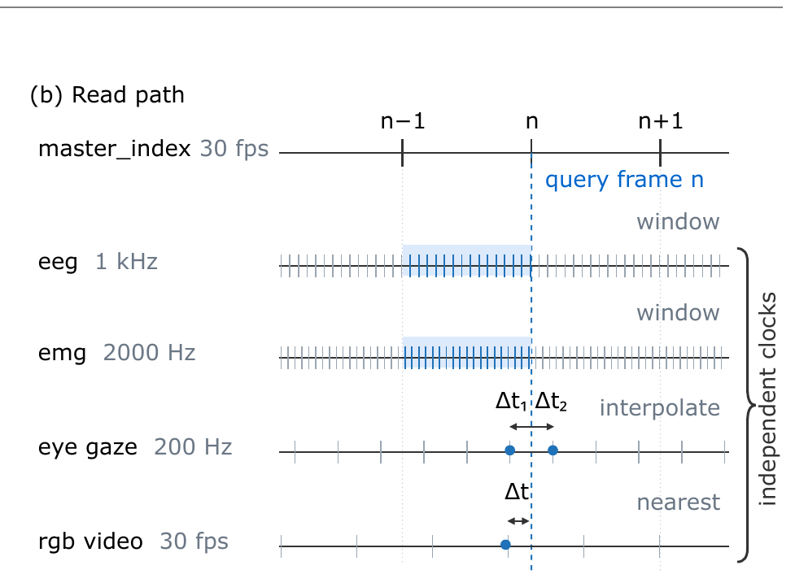

# On-disk format

A **task directory** is a self-contained LeRobot-style dataset. A repository holds one task directory at its root (L2/L3) or several task directories (L1).

```text
l1_study_room_fill_task_1920x1456_30fps_2views/
├── README.md
├── preview.jpg
├── portal.yaml
└── l1_study_room_fill_box_<hash>/        # task directory = dataset root
    ├── data/
    │   └── chunk-000/
    │       └── episode_000000/
    │           ├── master_index.parquet
    │           ├── observation.head_pose.parquet
    │           ├── observation.hand_left_points.parquet
    │           └── ...
    ├── videos/chunk-000/<view>/episode_000000.mp4
    ├── audios/chunk-000/<stream>/episode_000000.wav
    ├── calibrations/
    │   ├── dataset_manifest.json
    │   ├── rectify_params.yaml
    │   └── source_camera_calibration.json
    ├── annotation/
    │   └── episode_000000_structured.json
    └── meta/
        ├── info.json
        ├── episodes.jsonl
        ├── episodes_stats.jsonl
        ├── tasks.jsonl
        ├── readme.json
        ├── collect_info.jsonl          # when present
        ├── alignment_check.jsonl       # when present
        └── qc_reports.jsonl            # when present
```

L2/L3 repositories skip the extra level: `data/`, `videos/`, `meta/` sit at the repository root. `meta/info.json` is the marker: if it is not at the root, descend into the child that contains it.

## Per-stream tables

Every non-video signal is one Parquet file:

```text
timestamp (float64) | episode_index (int64) | channel_0 ... channel_D
```

- `timestamp` is seconds from the start of the recording, stored as recorded. Nothing is snapped to the master grid.
- `master_index.parquet` is the fixed-rate spine (30 fps in the released data): `timestamp | frame_index | episode_index | index | task_index`.
- RGB views are H.264 MP4; the matching `observation.images.*.parquet` lists frame timestamps.
- Raw and rectified video encodings live side by side where both are released.
- Audio, where present, is 16 kHz mono PCM WAV plus a per-frame sample-count table.
- Calibration ships with the episode: intrinsics, distortion, rectification and tracker transforms.
- Names are literal: `*_raw` is as acquired; `eeg_denoise` / `*_emg_denoise` is cleaned.

The authoritative feature list is always:

```python
for key, spec in ds.meta.features.items():
    if key in {"timestamp", "frame_index", "episode_index", "index", "task_index"}:
        continue
    print(f"{key:48s} {spec.get('dtype', ''):8s} {tuple(spec.get('shape', ()))}")
```

## Master clock and windows

Frame `i` has timestamp `t = i / fps` in the episode's master time base. Each feature is resolved around `t` according to its `window`:

| `window` | Returned value | Typical use |
|----------|----------------|-------------|
| `None` | nearest sample | 30 Hz state, RGB frame, audio chunk |
| `"interpolate"` | linear interpolation at `t` | mid-rate pose |
| `(start, end)` | all samples in `(t + start, t + end]` plus `<key>_timestamps` | gaze, EMG, EEG, IMU |

The window is stored in `meta/info.json` and can be overridden at read time:

```python
ds = HumanCOINDataset(
    repo_id="HumanCOIN/l3_bedroom_fold_clothes_eye_1600x1200_30fps_12views_eeg128_emg8",
    root="data/HumanCOIN/l3_bedroom_fold_clothes_eye_1600x1200_30fps_12views_eeg128_emg8",
    window_overrides={
        "observation.eye_gaze": (-1 / 30, 0.0),
        "observation.eeg_denoise": (-1 / 30, 0.0),
        "observation.left_wrist_emg": (-1 / 30, 0.0),
    },
)
```

<p align="center">
  
  <br>
  <sub>Read path (paper Fig. 6b): the master index defines frame n; each stream is resolved from its own clock. Figure from the paper.</sub>
</p>

## Depth, audio and missing data

- **Depth.** When `video.is_depth_map` is set and shape is `(H, W, 1)`, depth decodes as `(1, H, W)` in native units, without RGB conversion. Some releases store `(H, W)`; check `shape` first.
- **Audio.** Nearest reads return one chunk; a `(start, end)` window returns a sample-precise slice across chunks.
- **Missing data.** Lost tracking, invalid gaze and dead EEG channels appear as `NaN` or empty windows. High-rate windows can vary by a sample or two because timestamps are not snapped to the grid.
