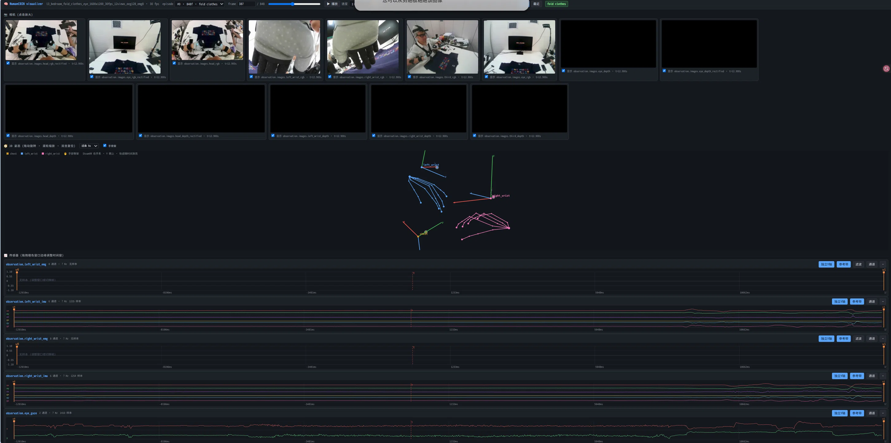

# Visualization

## Browser viewer

```bash
# DATASET_ROOT is a task directory; for a flat L2/L3 repository it is the root
humancoin-visualize-web "<dataset-root>"
# choose a port or bind address if needed
humancoin-visualize-web "<dataset-root>" --port 8080 --no-browser
```

The viewer serves a local page with synchronized camera panels, signal strips, a draggable time window, a 3D pose/hand-skeleton view where those streams exist, and — when an impedance snapshot is available — a color-coded EEG electrode grid.

On EEG and EMG strips you can apply a zero-phase Butterworth high-pass/low-pass and a comb notch at the line frequency and its harmonics. The same filter is available over the API:

```text
filt=observation.eeg_denoise:hp=0.5,lp=40,notch=50
```

<p align="center">
  
  <br>
  <sub>The browser viewer on a real L3 episode (frame 381/848): camera wall, 3D pose, EMG/IMU and gaze strips on the master timeline.</sub>
</p>

## Desktop viewer

```bash
humancoin-visualize "<dataset-root>" --episode 0
```

| Key | Action |
|-----|--------|
| `space` | play / pause |
| `←` `→` | previous / next frame |
| `↑` `↓` | faster / slower |
| `w` `s` | widen / shrink the time window |
| `q` / `Esc` | quit |

The desktop viewer shows every stream as a strip. For L3 data with 132 EEG columns, the browser viewer is easier to read.

## Portal preview

The [data portal](https://flagopen.github.io/HumanCOIN-DataManager/) previews a repository before download: poster, sensor list, episodes, duration, size and license. Full video previews stream from Hugging Face, so gated repositories need access first.
