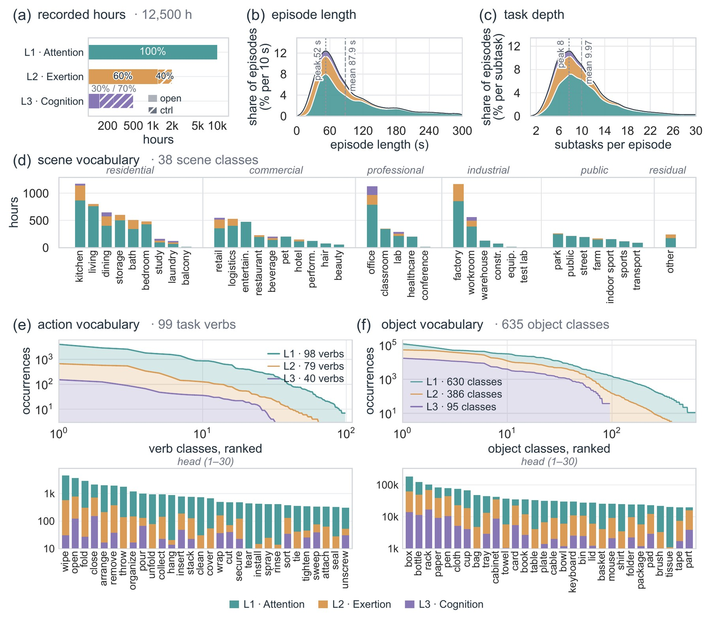

# HumanCOIN

> English docs: [English](../en/)

  

**一个 12,500 小时的第一视角操作数据集：在统一任务本体与统一时间轴上，按三种测量深度记录动作背后的意图信号——注视、表面肌电与脑电。**

  <a href="https://flagopen.github.io/HumanCOIN/">项目主页</a> ·
  <a href="https://arxiv.org/abs/2611.26434">论文（arXiv:2611.26434）</a> ·
  <a href="https://flagopen.github.io/HumanCOIN-DataManager/">数据门户</a> ·
  <a href="https://github.com/FlagOpen/HumanCOIN">GitHub</a>

HumanCOIN 记录“看见”和“行动”之间的那一段。多数第一视角数据集保留的是观测–动作对；HumanCOIN 增加三种可穿戴的意图代理信号：

- **注视**——手出发之前，注意力落在哪里；
- **表面肌电**——接触之前，前臂如何为握力加载；
- **头皮脑电**——运动命令下达之前，皮层准备了什么。

语料按三层嵌套组织：**L1 注意**（10,000 h）、**L2 用力**（2,000 h）和 **L3 认知**（500 h）。每层继承下一层的全部代理信号，再增加一种。每层都包含多视角 RGB、深度与点云、6-DoF 位姿和手指运动学；L3 的受控子集直接测量注视、位姿和手指运动学，作为参考。

## 一览

| 维度 | 数值 |
|------|------|
| 规模 | 12,500 小时 · 30 fps 下约 13.5 亿个主帧 · 6 个采集点 |
| 场景 | 5 个功能区共 38 类 + 1 个残差类 |
| 任务 | 99 个任务动词 + 46 个动作动词 |
| 物体 | 635 个标注类别；839 个实测实例 |
| 信号 | 多视角 RGB、深度、6-DoF 位姿、手部运动学、注视、sEMG、EEG、IMU、麦克风 |
| 格式 | LeRobot 风格：每个数据流一个 Parquet + 主索引；MP4 与 WAV |

  
   
  三层小时数、episode 长度、任务深度、38 类场景、任务动词与物体类别。图源：论文。

## 从这里开始

- **[快速开始](getting-started.md)**——安装、下载一个仓库、读取一帧。
- **[数据里有什么](data.md)**——形式化框架、层级、episode 解剖与标注。
- **[磁盘上的格式](format.md)**——目录、时间戳、主索引与逐流表。
- **[下载数据](download.md)**——数据门户、CLI 与 ModelScope 访问。
- **[读取与对齐](reading.md)**——窗口、最近邻与插值。
- **[可视化](visualization.md)**——浏览器与桌面可视化器。
- **[使用数据](usage.md)**——默认帧 + gaze/EMG/EEG demo。
- **[采集与处理](collection.md)**——硬件、协议与质检。
- **[参考](reference.md)**——CLI、对比、FAQ 与引用。

> **目录与语料不是一回事。** 12,500 小时是完整语料规模，数据分批发布；实时目录以[数据门户](https://flagopen.github.io/HumanCOIN-DataManager/)为准。2026-11 快照约为 689 个仓库、12,119 个 episode、530 小时。
