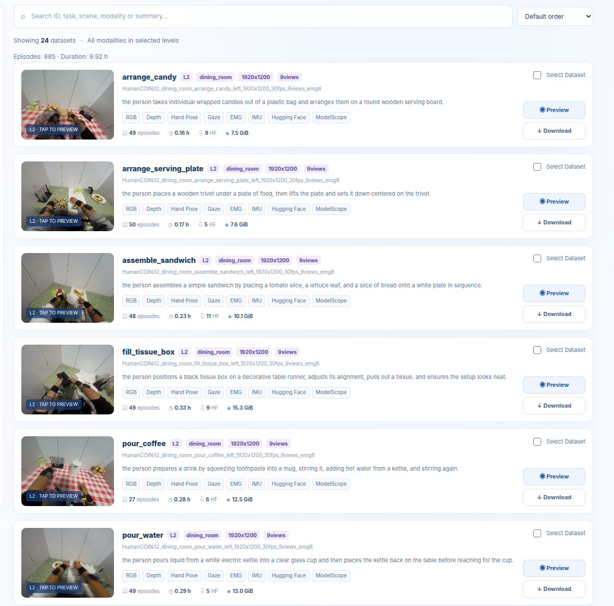
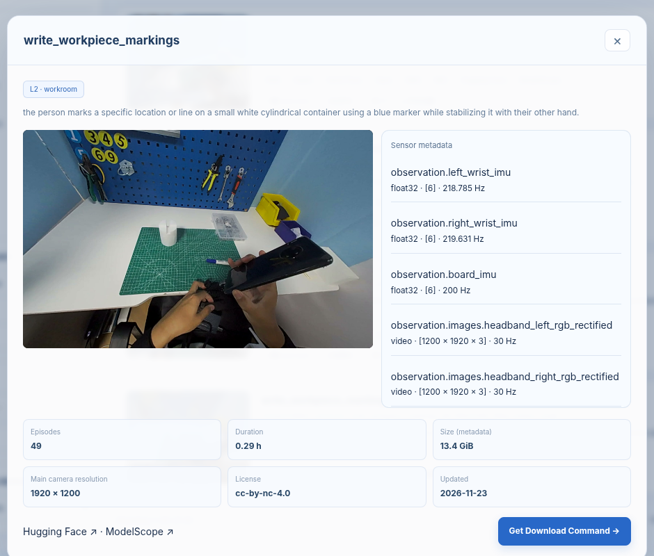
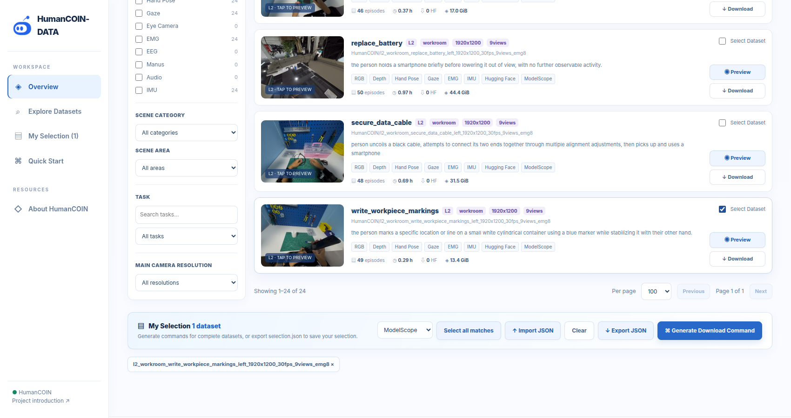

# 下载数据

有两种方式：用门户生成命令，或手写同样的 `humancoin-download` 命令。

## 数据门户

**[HumanCOIN 数据门户](https://flagopen.github.io/HumanCOIN-DataManager/)** 是已发布数据的公开目录。

<p align="center">
  
  <br>
  <sub>Explore Datasets：搜索、比较仓库；每张卡片给出传感器集合、大小以及 Preview/Download。</sub>
</p>

<p align="center">
  
  <br>
  <sub>数据集卡片：任务、逐流元数据、episode 数、时长、大小、许可与 Get Download Command。</sub>
</p>

1. **浏览。** 按层级、模态、场景、任务和主相机分辨率筛选。
2. **预览。** 查看任务、流列表、episode 数、时长、大小和许可。
3. **选择。** 勾选一个或多个完整仓库；选择保存在浏览器里，可以导出/导入 `selection.json`。
4. **选择源。** Hugging Face 或 ModelScope；有的仓库只在一个平台发布。
5. **生成命令。** 命令使用卡片上的修订版本。

```bash
humancoin-download --hub huggingface \
  --datasets 'HumanCOIN/<repository>' \
  --revision '<commit-or-master>' \
  --target-dir ./data --max-workers 8
```

在完成认证的同一个终端执行。`--dry-run` 只打印目标路径和 include/exclude 规则。

## 仓库命名

```text
l1_study_room_fill_task_1920x1456_30fps_2views
│  │          │    │        │      │     └─ 发布的相机视角数
│  │          │    │        │      └─ 帧率
│  │          │    │        └─ 主相机分辨率
│  │          │    └─ 任务
│  │          └─ 场景
│  └─ 层级
```

L2/L3 在末尾追加传感器组合，例如 `..._9views_emg8` 或 `..._12views_eeg128_emg8`。

## 命令行

```bash
humancoin-download --help
# 也可以：python -m humancoin.download --help
```

| 参数 | 含义 |
|------|------|
| `--hub {huggingface,modelscope}` | 数据源 |
| `--datasets A B ...` | 一个或多个仓库名或 `owner/name` |
| `--revision REV` | 分支、标签或 commit |
| `--target-dir DIR` | 下载根目录；文件写到 `DIR/HumanCOIN/<name>` |
| `--max-workers N` | 并行下载数 |
| `--include` / `--exclude` | 相对路径 glob，用于部分下载 |
| `--dry-run` | 只打印计划 |
| `--token TOKEN` | 访问令牌；优先使用环境变量 |

示例：

```bash
# 多个仓库
humancoin-download --hub huggingface \
  --datasets 'HumanCOIN/l1_study_room_fill_task_1920x1456_30fps_2views' \
             'HumanCOIN/l3_bedroom_fold_clothes_eye_1600x1200_30fps_12views_eeg128_emg8' \
  --target-dir ./data --max-workers 8

# 先看计划
humancoin-download --datasets 'HumanCOIN/l1_study_room_fill_task_1920x1456_30fps_2views' \
  --target-dir ./data --dry-run
```

重复执行是安全的：Hub SDK 会复用已有文件。某个仓库失败不会中断其余仓库；只要有失败，进程返回非零退出码。

## Hugging Face 访问

多数仓库是 gated。先在数据集页面申请访问，等待通过，然后：

```bash
hf auth login
hf auth whoami
```

返回 401/403 通常是审批未通过，或 token 属于另一个账号。

## ModelScope

ModelScope 提供镜像。下载受限仓库时：

1. 用将执行下载的账号，在 ModelScope 数据集页面申请访问。
2. 用同一账号创建 [ModelScope 访问令牌](https://modelscope.cn/my/myaccesstoken)。
3. 交互式导出令牌，避免进入 shell 历史：

```bash
read -rsp 'ModelScope Token: ' MODELSCOPE_TOKEN
printf '\n'
export MODELSCOPE_TOKEN
```

4. 勾选仓库，把数据源切到 **ModelScope**，生成命令：

<p align="center">
  
  <br>
  <sub>勾选完整仓库，选择 ModelScope，再点 Generate Download Command；同一个选择栏可以导出 selection.json。</sub>
</p>

```bash
humancoin-download --hub modelscope \
  --datasets 'HumanCOIN/l2_workroom_write_workpiece_markings_left_1920x1200_30fps_9views_emg8' \
  --revision 'master' \
  --target-dir ./data --max-workers 8
```

文件落在 `./data/HumanCOIN/<仓库名>/`，布局与 Hugging Face 相同。`--dry-run`、`--include`/`--exclude` 和 `selection.json` 用法一致。下载器读取 `MODELSCOPE_TOKEN` 或 `MS_TOKEN`；也可以用 `--token`。`master` 是可变分支，需要字节级复现时固定 commit 或 tag。

## 磁盘与校验

体积差异很大：快速开始的 L1 示例 65 MB，而 L2/L3 仓库通常为多 GB，最大的超过 60 GB；完整已发布目录约 7.5 TB。

扁平的 L2/L3 仓库在根目录有 `meta/info.json`；L1 在每个 `<task>/meta/info.json` 下。完整任务目录还应至少有一个 `data/chunk-*/episode_*/master_index.parquet`。
