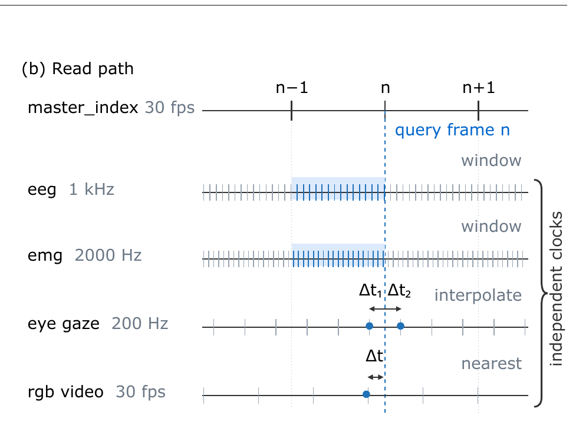

# 磁盘上的格式

一个**任务目录**是一个自包含的 LeRobot 风格数据集。仓库可能是“根目录就是任务目录”（L2/L3），也可能在根目录下放多个任务目录（L1）。

```text
l1_study_room_fill_task_1920x1456_30fps_2views/
├── README.md
├── preview.jpg
├── portal.yaml
└── l1_study_room_fill_box_<hash>/        # 任务目录 = 数据集根目录
    ├── data/
    │   └── chunk-000/
    │       └── episode_000000/
    │           ├── master_index.parquet
    │           ├── observation.head_pose.parquet
    │           ├── observation.hand_left_points.parquet
    │           └── ...
    ├── videos/chunk-000/<view>/episode_000000.mp4
    ├── audios/chunk-000/<stream>/episode_000000.wav
    ├── calibrations/
    │   ├── dataset_manifest.json
    │   ├── rectify_params.yaml
    │   └── source_camera_calibration.json
    ├── annotation/
    │   └── episode_000000_structured.json
    └── meta/
        ├── info.json
        ├── episodes.jsonl
        ├── episodes_stats.jsonl
        ├── tasks.jsonl
        ├── readme.json
        ├── collect_info.jsonl          # 存在时
        ├── alignment_check.jsonl       # 存在时
        └── qc_reports.jsonl            # 存在时
```

L2/L3 仓库没有这一层：`data/`、`videos/`、`meta/` 直接在仓库根目录。判断依据是 `meta/info.json`——根目录没有它，就进入包含它的子目录。

## 逐流表

每个非视频信号是一个 Parquet：

```text
timestamp (float64) | episode_index (int64) | channel_0 ... channel_D
```

- `timestamp` 是相对录制起点的秒数，按采集值存储，不吸附到主帧网格。
- `master_index.parquet` 是固定频率主干（发布数据为 30 fps）：`timestamp | frame_index | episode_index | index | task_index`。
- RGB 视角是 H.264 MP4；同名 `observation.images.*.parquet` 记录每一帧的时间戳。
- 发布同时提供原始与校正版本时就都保留。
- 有音频时是 16 kHz 单声道 PCM WAV，加一张逐帧采样数表。
- 标定随 episode 发布：内参、畸变、校正参数和 tracker 变换。
- 命名是字面含义：`*_raw` 是原始流；`eeg_denoise` / `*_emg_denoise` 是清洗后的流。

权威特征列表：

```python
for key, spec in ds.meta.features.items():
    if key in {"timestamp", "frame_index", "episode_index", "index", "task_index"}:
        continue
    print(f"{key:48s} {spec.get('dtype', ''):8s} {tuple(spec.get('shape', ()))}")
```

## 主时钟与窗口

第 `i` 帧的时间戳是 `t = i / fps`。每一路围绕 `t` 按自己的 `window` 解析：

| `window` | 返回值 | 典型用途 |
|----------|--------|----------|
| `None` | 最近的一个采样 | 30 Hz 状态、RGB 帧、音频 chunk |
| `"interpolate"` | 在 `t` 处线性插值 | 中频位姿 |
| `(start, end)` | `(t + start, t + end]` 内的全部采样 + `<key>_timestamps` | 注视、肌电、脑电、IMU |

窗口存放在 `meta/info.json`，读取时可以覆盖：

```python
ds = HumanCOINDataset(
    repo_id="HumanCOIN/l3_bedroom_fold_clothes_eye_1600x1200_30fps_12views_eeg128_emg8",
    root="data/HumanCOIN/l3_bedroom_fold_clothes_eye_1600x1200_30fps_12views_eeg128_emg8",
    window_overrides={
        "observation.eye_gaze": (-1 / 30, 0.0),
        "observation.eeg_denoise": (-1 / 30, 0.0),
        "observation.left_wrist_emg": (-1 / 30, 0.0),
    },
)
```

<p align="center">
  
  <br>
  <sub>读取路径（论文 Fig. 6b）：主索引给出第 n 帧，每一路按自己的时钟解析。图源：论文。</sub>
</p>

## 深度、音频与缺失值

- **深度。** 元数据标记 `video.is_depth_map` 且形状为 `(H, W, 1)` 时，按原生单位解码为 `(1, H, W)`，不做 RGB 转换。部分发布存成 `(H, W)`，先看 `shape`。
- **音频。** 最近邻读取返回一个 chunk；`(start, end)` 窗口返回跨 chunk 的精确采样切片。
- **缺失。** 跟踪丢失、无效注视、坏导联会表现为 `NaN` 或空窗口。高频窗口长度可能相差一两个采样。
